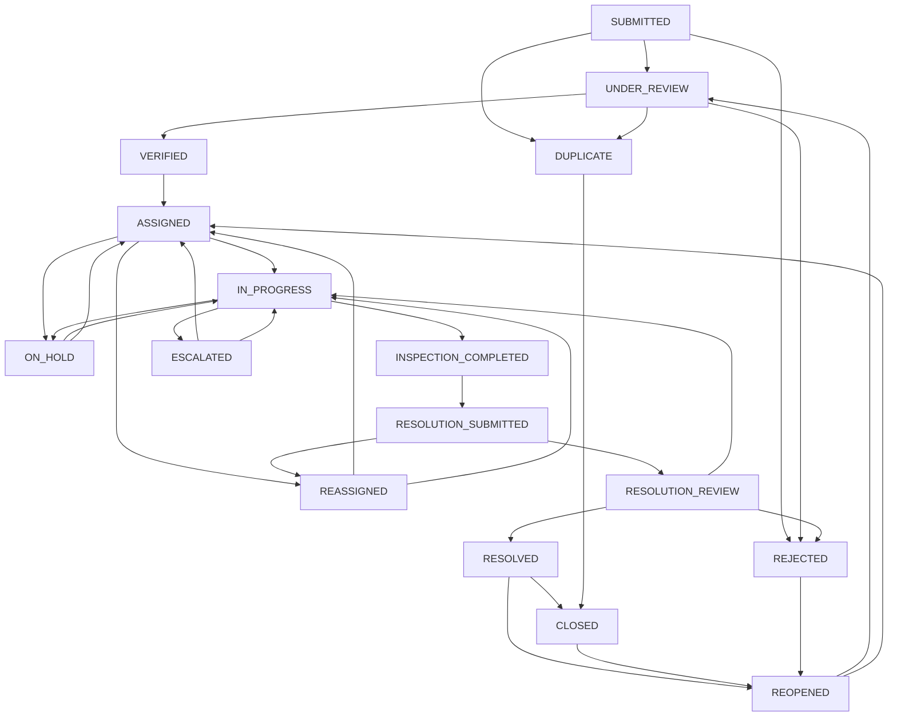

# 🌬️ MumbAIR
### Greater Mumbai Air Quality Intelligence & Municipal Operations Platform

> **Observe → Understand → Report → Assign → Investigate → Act → Verify → Improve**

**Unified Environmental Surveillance & Municipal Governance Suite** for the 24 administrative wards of Greater Mumbai — Brihanmumbai Municipal Corporation (BMC / MCGM).

---

<p align="center">
  <b>Environmental Intelligence · Civic Accountability · Municipal Operations · Scientific Transparency</b>
</p>

---

## 📑 Table of Contents

| # | Section | # | Section |
|---|---|---|---|
| 01 | [Executive Summary & Purpose](#1-executive-summary--purpose) | 11 | [Storage Architecture & Atomic Transactions](#11-storage-architecture--atomic-state-transactions) |
| 02 | [Ecosystem Architecture](#2-ecosystem-architecture) | 12 | [Geospatial Map Intelligence](#12-geospatial-map-intelligence--satellite-layers) |
| 03 | [Technology Stack](#3-technology-stack) | 13 | [Desktop Responsiveness](#13-desktop-header-responsiveness--viewport-compatibility) |
| 04 | [Official CPCB NAQI Engine](#4-official-cpcb-national-aqi-naqi-calculation-engine) | 14 | [Adaptive Mobile Experience](#14-adaptive-mobile-experience) |
| 05 | [Atmospheric Telemetry & Transparency](#5-atmospheric-telemetry--source-transparency) | 15 | [Document & Report Studio](#15-document--report-studio) |
| 06 | [Complaint Lifecycle](#6-validated-16-state-complaint-lifecycle) | 16 | [Environmental Bulletins](#16-verified-mumbai-news--environmental-bulletins) |
| 07 | [RBAC & Scope Boundaries](#7-role-based-access-control-rbac--scope-boundaries) | 17 | [Automated Test Suite](#17-automated-test-suite--verification-instructions) |
| 08 | [Four-Eyes Verification](#8-separation-of-duties--four-eyes-verification) | 18 | [Project File Inventory](#18-project-file-inventory) |
| 09 | [SLA Engine](#9-sla-calculation-engine--deadline-enforcement) | 19 | [Local Setup & Startup](#19-local-setup--startup-guide) |
| 10 | [Application Security](#10-application-security--injection-hardening) | 20 | [Limitations & Transparency](#20-system-limitations--operational-transparency) |

---

## 1. Executive Summary & Purpose

**MumbAIR** is a full-featured, scientifically grounded environmental intelligence and municipal operations platform purpose-built for residents and municipal administration across Greater Mumbai.

### Mumbai's Atmospheric Challenges

| Environmental Challenge | Impact & Context |
|---|---|
| 🌡️ **Nocturnal Coastal Temperature Inversions** | Low-altitude atmospheric conditions that can trap pollutants near the surface. |
| 🏗️ **Heavy Redevelopment & Demolition** | Construction activity and demolition generate coarse particulate matter (PM₁₀) and fugitive dust. |
| 🏭 **Refinery & Chemical Corridors** | Industrial emissions involving SO₂ and other pollutants around Chembur, Mahul and Trombay. |
| 🔥 **Legacy Landfill Smoldering** | Smoke and particulate emissions associated with landfill fires and subsurface combustion at Deonar and Mulund dumping grounds. |
| 🚗 **Arterial Traffic Congestion** | Road traffic contributes to NO₂ and particulate pollution along the Western and Eastern Express Highways. |

MumbAIR bridges public atmospheric awareness and verifiable municipal accountability. It provides citizens with transparent air-quality information while equipping municipal authorities with a structured, auditable operations-management platform.

### Core Operational Philosophy

```text
OBSERVE
   ↓
UNDERSTAND
   ↓
REPORT
   ↓
ASSIGN
   ↓
INVESTIGATE
   ↓
ACT
   ↓
VERIFY
   ↓
IMPROVE
```

---

## 2. Ecosystem Architecture

MumbAIR is divided into two distinct operational portals sharing a synchronized state engine.

### 2.1 Citizen Portal

| Module | Capabilities |
|---|---|
| 🌬️ **Real-Time AQI Dashboard** | Dynamic SVG gauge, CPCB categories, AQI scale and dominant pollutant detection. |
| 🌦️ **Weather Telemetry** | Temperature, relative humidity, wind velocity and wind direction. |
| 🧪 **Pollutant Analysis** | Six-parameter pollutant breakdown benchmarked against CPCB standards with CAMS model attribution. |
| 🗺️ **Interactive Map** | Multiple basemaps, monitoring stations, administrative wards and geotagged complaints. |
| 📸 **Civic Reporting Wizard** | Three-step complaint submission, GPS capture, duplicate detection and ward routing. |
| 📋 **Complaint Tracking Feed** | Public complaint status, category filters, endorsement/upvoting and lifecycle transparency. |
| 📰 **Environmental Bulletin** | Curated environmental updates and official circulars from MCGM, MPCB and CPCB. |
| 🌱 **Solutions Center** | Evidence-based citizen guidance and municipal mitigation tracking. |
| 🎨 **Appearance Customizer** | Six themes with CPCB AQI severity colors preserved. |
| 📄 **Report Studio** | Complaint receipts, print-ready PDF reports and CSV downloads. |

### 2.2 Municipal Operations Portal — `#authority`

| Module | Capabilities |
|---|---|
| 🔐 **Role-Based Authentication** | Demo personas for Field Officer, Ward Officer, Department Head, City Admin and Super Admin. |
| 🏛️ **Command Center** | Caseload KPIs, SLA breaches, operational triage and ward ledger. |
| 📥 **Complaint Inbox** | Central registry, filtering, priority overrides and role-scoped exports. |
| 🚚 **Dispatch & Assignment** | Officer assignment, workload-aware dispatch, SLA benchmarks and supervisor directives. |
| 🔍 **Field Inspection Engine** | Mobile checklists, opacity checks, inspection notes, mitigation evidence and spot-fine notice triggers. |
| ⚖️ **Four-Eyes Verification** | Independent resolution approval with self-approval restrictions. |
| 🏙️ **Ward & Department Matrix** | Scorecards for 24 wards and civic departments. |
| 🚛 **Resource & Fleet Management** | Anti-smog guns, mobile monitoring vans and mechanized sweepers. |
| 🤖 **Ops AI Assistant** | Deterministic analysis of bottlenecks, repeat complaints and executive briefings. |
| 🧾 **Audit Trail Ledger** | Append-oriented records of dispatch, inspection, verification and administrative actions. |

---

## 3. Technology Stack

| Layer | Technology | Purpose |
|---|---|---|
| Frontend | HTML5, CSS3, Vanilla JavaScript (ES6+) | Zero-build application architecture |
| Mapping | Leaflet 1.9.4 | Interactive geospatial intelligence |
| Charts | Chart.js 4.4.1 | AQI trends, time-series and comparative analytics |
| Atmospheric API | Open-Meteo Air Quality API | Pollutant telemetry |
| Atmospheric Model | Copernicus CAMS | Model-based atmospheric estimates |
| Weather API | Open-Meteo Weather Forecast API | Meteorological telemetry |
| State Management | Browser `localStorage` | Demo persistence and synchronization |
| Production Database | PostgreSQL | Relational storage architecture |
| Database Security | PostgreSQL Row-Level Security (RLS) | Production access isolation |
| Backend Demo Server | Node.js | Zero-dependency local HTTP server |
| Testing | Node.js test runner | Automated algorithm and workflow validation |

### External Services & Basemap Providers

| Provider | Layer |
|---|---|
| Esri ArcGIS | World Street Map |
| Esri ArcGIS | World Imagery Satellite |
| Esri ArcGIS | World Light Gray Canvas |
| OpenStreetMap HOT | Humanitarian basemap |
| Open-Meteo | Air quality and weather telemetry |
| Copernicus CAMS | Atmospheric model data |

> **Architecture:** The application uses a zero-build frontend. No bundler, transpiler or framework compilation is required to run the demo.

---

## 4. Official CPCB National AQI (NAQI) Calculation Engine

MumbAIR implements the Central Pollution Control Board (CPCB) National Air Quality Index methodology using pollutant-specific breakpoint interpolation.

### 4.1 Sub-Index Linear Interpolation

For pollutant concentration \(C_p\) falling within the breakpoint interval \([B_{LO},B_{HI}]\), corresponding to the index interval \([I_{LO},I_{HI}]\):

$$
I_p =
\frac{I_{HI}-I_{LO}}{B_{HI}-B_{LO}}
(C_p-B_{LO})+I_{LO}
$$

### 4.2 Composite AQI

The overall AQI is determined by the maximum valid pollutant sub-index:

$$
AQI=\max(I_{PM2.5},I_{PM10},I_{NO2},I_{SO2},I_{CO},I_{O3},I_{NH3})
$$

### 4.3 CPCB AQI Categories

| AQI Range | Category | Health Implication |
|---:|---|---|
| 0–50 | 🟢 Good | Minimal impact |
| 51–100 | 🟡 Satisfactory | Minor breathing discomfort to sensitive individuals |
| 101–200 | 🟠 Moderate | Discomfort among sensitive individuals |
| 201–300 | 🔴 Poor | Breathing discomfort with prolonged exposure |
| 301–400 | 🟣 Very Poor | Respiratory effects with prolonged exposure |
| 401–500 | 🟤 Severe | Health effects even among healthy individuals; serious effects for vulnerable groups |

### 4.4 Official CPCB Breakpoint Matrix

| Pollutant | Good (0–50) | Satisfactory (51–100) | Moderate (101–200) | Poor (201–300) | Very Poor (301–400) | Severe (401–500) |
|---|---:|---:|---:|---:|---:|---:|
| **PM₂.₅ (µg/m³)** | 0–30 | 31–60 | 61–90 | 91–120 | 121–250 | 251–500 |
| **PM₁₀ (µg/m³)** | 0–50 | 51–100 | 101–250 | 251–350 | 351–430 | 431–600 |
| **NO₂ (µg/m³)** | 0–40 | 41–80 | 81–180 | 181–280 | 281–400 | 401–500 |
| **SO₂ (µg/m³)** | 0–40 | 41–80 | 81–380 | 381–800 | 801–1600 | 1601–2000 |
| **CO (mg/m³)** | 0–1.0 | 1.1–2.0 | 2.1–10.0 | 10.1–17.0 | 17.1–34.0 | 34.1–50.0 |
| **O₃ (µg/m³)** | 0–50 | 51–100 | 101–168 | 169–208 | 209–748 | 749–1000 |
| **NH₃ (µg/m³)** | 0–200 | 201–400 | 401–800 | 801–1200 | 1201–1800 | 1801–2500 |

### 4.5 Critical Engineering Safeguards

| Safeguard | Implementation |
|---|---|
| **CO Unit Normalization** | Open-Meteo CO values in µg/m³ are normalized to mg/m³ where necessary before CPCB breakpoint evaluation. |
| **CPCB 3-Parameter Mandate** | Official AQI requires at least three pollutant parameters, including at least one particulate pollutant (PM₂.₅ or PM₁₀). |
| **Indicative AQI Handling** | Incomplete datasets are flagged `isOfficial: false` and shown with an Indicative Only disclaimer. |
| **No Fabricated Multipliers** | Arbitrary pollutant scaling is prohibited. |
| **Fractional Precision** | Interpolation is calculated before final rounding to minimize boundary inaccuracies. |
| **Invalid Data Handling** | Missing and invalid pollutant data are handled without producing `NaN` AQI values. |

---

## 5. Atmospheric Telemetry & Source Transparency

MumbAIR distinguishes model estimates from physical station measurements.

| Data Source | Description | Classification |
|---|---|---|
| **Copernicus CAMS Grid** | Atmospheric pollutant estimates from an approximately 11 km model grid | Model-derived |
| **CAAQMS Stations** | Physical coordinates of Continuous Ambient Air Quality Monitoring Stations | Station reference |
| **Offline Baseline** | Calibrated fallback records used when internet connectivity is unavailable | Simulated baseline |

### Data Transparency Principles

- **Model Attribution:** Model-based values are explicitly labeled as originating from the Copernicus CAMS grid.
- **Station Distinction:** Physical CAAQMS monitoring station locations are not misrepresented as model grid points.
- **Offline Transparency:** Cached offline readings are identified as simulated baseline data.
- **Coordinate-Specific Cache:** Cache keys use geographic coordinates to prevent cross-ward contamination.
- **Source Traceability:** Users can distinguish measured station data from model-derived atmospheric estimates.

---

## 6. Validated 16-State Complaint Lifecycle

MumbAIR uses a centralized, validated complaint state machine governed by `CONFIG.STATUS_LIFECYCLE`.

### 6.1 Complaint Workflow



### 6.2 Transition & Prerequisite Matrix

| Current State | Legal Next States | Mandatory Prerequisites |
|---|---|---|
| `SUBMITTED` | `UNDER_REVIEW`, `DUPLICATE`, `REJECTED` | Valid GPS, citizen contact and category |
| `UNDER_REVIEW` | `VERIFIED`, `REJECTED`, `DUPLICATE` | Preliminary ward officer triage notes |
| `VERIFIED` | `ASSIGNED`, `REJECTED` | Ward verification sign-off |
| `ASSIGNED` | `IN_PROGRESS`, `REASSIGNED`, `ON_HOLD` | Valid officer ID and SLA |
| `IN_PROGRESS` | `INSPECTION_COMPLETED`, `ESCALATED`, `ON_HOLD` | Field checklist execution |
| `INSPECTION_COMPLETED` | `RESOLUTION_SUBMITTED`, `ESCALATED` | Inspection notes and opacity check |
| `RESOLUTION_SUBMITTED` | `RESOLUTION_REVIEW`, `REASSIGNED` | Photographic mitigation evidence |
| `RESOLUTION_REVIEW` | `RESOLVED`, `REJECTED`, `IN_PROGRESS` | Independent supervisory review |
| `ON_HOLD` | `IN_PROGRESS`, `ASSIGNED` | Mandatory documented justification |
| `ESCALATED` | `ASSIGNED`, `IN_PROGRESS` | Escalation reason and priority boost |
| `REASSIGNED` | `ASSIGNED`, `IN_PROGRESS` | Transfer reason |
| `REOPENED` | `UNDER_REVIEW`, `ASSIGNED` | Citizen/supervisor reopening reason |
| `RESOLVED` | `CLOSED`, `REOPENED` | Approved resolution verification |
| `REJECTED` | `REOPENED` | Mandatory rejection reason |
| `DUPLICATE` | `CLOSED` | Parent complaint ID |
| `CLOSED` | `REOPENED` | Final archival record |

---

## 7. Role-Based Access Control (RBAC) & Scope Boundaries

MumbAIR enforces geographic and functional scope boundaries across all user personas.

### 7.1 Role Permissions Matrix

| Role | Scope | Allowed Actions |
|---|---|---|
| `CITIZEN` | Own complaints | File reports, track status, endorse public complaints and export personal receipts |
| `FIELD_OFFICER` | Assigned cases only | View assigned cases, complete checklists and submit photographic resolution proof |
| `WARD_OFFICER` | Assigned ward | Triage ward cases, dispatch officers, verify resolutions and publish advisories |
| `DEPARTMENT_HEAD` | Assigned department | Allocate departmental caseload, manage fleet and audit compliance |
| `CITY_ADMIN` | All 24 wards | City-wide oversight, cross-ward reallocation, ledger exports and executive analytics |
| `SUPER_ADMIN` | System administration | Diagnostics, audit inspection, schema and security configuration |

### 7.2 Verified Demo Roster

| Persona | Demo Identity | Scope |
|---|---|---|
| Field Officer | `sanjay.shinde@mcgm.gov.in.demo` | Ward M/E · Solid Waste Management |
| Ward Executive Officer | `priya.sharma@mcgm.gov.in.demo` | Ward M/E · Ward Executive Officer |
| Department Head | `vikram.deshmukh@mcgm.gov.in.demo` | City-wide · Air Pollution Control |
| City Administrator | `commissioner.ops@mcgm.gov.in.demo` | Greater Mumbai Operations Command |
| Super Admin | `root.admin@mcgm.gov.in.demo` | System Security & Governance |

> **Security Note:** These personas represent demonstration identities and must not be interpreted as verified real-world municipal accounts. Production authentication requires a secure identity provider and server-side authorization.

---

## 8. Separation of Duties & Four-Eyes Verification

MumbAIR implements the **Four-Eyes Principle** to prevent unilateral approval of field mitigation and fraudulent case closure.

### Verification Controls

| Control | Enforcement |
|---|---|
| 🚫 Self-Approval Prevention | The inspecting officer cannot approve their own submitted resolution. |
| 👁️ Independent Review | Resolutions require review by a Ward Officer, Department Head or City Admin. |
| 📝 Mandatory Review Notes | Supervisory assessment requires at least 10 characters. |
| 📸 Evidence Comparison | Citizen evidence and field mitigation evidence are compared side by side. |
| ↩️ Rejection Workflow | Rejected resolutions return the case to `IN_PROGRESS` with remedial instructions. |
| 🔒 Super Admin Guard | Super Admin is restricted from routine operational field approvals. |

### Self-Approval Guard

```javascript
if (actor.id === complaint.assignedOfficerId) {
    // Resolution approval must be blocked
}
```

### Verification Process

```text
Field Inspection
      ↓
Resolution Submitted
      ↓
Independent Supervisor Review
      ↓
Compare Evidence + Assessment Notes
      ↓
 ┌───────────────┴────────────────┐
 │                                │
 ACCEPT                         REJECT
 │                                │
 RESOLVED                 IN_PROGRESS
                                  │
                       Remedial Instructions
```

---

## 9. SLA Calculation Engine & Deadline Enforcement

MumbAIR distinguishes operational status from deadline compliance.

| Status | Condition | Compliance |
|---|---|---|
| `ON_TRACK` | Active case before deadline | Compliant |
| `DUE_SOON` | Remaining time below 25% of benchmark | Compliant |
| `BREACHED` | Active case exceeds SLA deadline | Non-compliant |
| `PAUSED` | Justified `ON_HOLD` state | Clock frozen |
| `COMPLETED_ON_TIME` | Resolution timestamp ≤ deadline | Compliant |
| `COMPLETED_LATE` | Resolution timestamp > deadline | Non-compliant |

### SLA Benchmarks

| Priority / Resolution Class | Benchmark |
|---|---:|
| Critical | 6 hours |
| High | 24 hours |
| Medium | 48 hours |
| Standard | 72 hours |

The SLA engine records deadlines, paused intervals, completion timestamps and late-resolution outcomes to support accountability.

---

## 10. Application Security & Injection Hardening

### 10.1 Context-Safe HTML Escaping — Stored XSS Defense

Citizen inputs such as complaint titles, descriptions, locations and user names are escaped before HTML insertion.

```javascript
function escapeHtml(str) {
    if (str === null || str === undefined) return '';

    return String(str)
        .replace(/&/g, '&amp;')
        .replace(/</g, '&lt;')
        .replace(/>/g, '&gt;')
        .replace(/"/g, '&quot;')
        .replace(/'/g, '&#39;');
}
```

### 10.2 CSV Formula Injection Defense — CWE-1236

Spreadsheet applications may interpret cells beginning with formula-triggering characters as executable formulas.

```javascript
function sanitizeCsvCell(val) {
    if (val === null || val === undefined) return '""';

    var str = String(val).trim();
    var firstChar = str.charAt(0);

    if (['=', '+', '-', '@', '\t', '\r'].indexOf(firstChar) >= 0) {
        str = "'" + str;
    }

    return '"' + str.replace(/"/g, '""') + '"';
}
```

### 10.3 UTF-8 BOM — Excel Devanagari Preservation

CSV downloads are prefixed with a UTF-8 Byte Order Mark (`\uFEFF`) to improve Marathi and Hindi text compatibility in Microsoft Excel.

**Example ward names:**

- मानखुर्द
- वरळी
- अंधेरी

### 10.4 Privacy & Scoped Access

| Data | Protection |
|---|---|
| Citizen phone numbers | Masked in standard municipal views |
| Supervisory access | Unmasked access restricted to authorized roles |
| Citizen complaints | Scope-limited according to role |
| Operational exports | Permission-scoped |
| Audit records | Append-oriented and attributable |

---

## 11. Storage Architecture & Atomic State Transactions

MumbAIR uses a centralized atomic transaction wrapper to minimize lost-write race conditions and inconsistent state mutations.

### 11.1 Atomic Mutation

```javascript
STORAGE.atomicUpdate(function(state) {

    // 1. Receives fresh state
    // 2. Applies validated mutations
    // 3. Appends audit log and notification

    return { success: true };
});
```

### 11.2 Storage Safeguards

| Safeguard | Description |
|---|---|
| Schema Versioning | `SCHEMA_VERSION = 4` |
| Storage Namespace | `mumbair_state_v4` |
| Initialization Guard | `_initialized` flag prevents unintended reseeding |
| Empty Collections | Valid empty arrays remain empty |
| Corruption Recovery | JSON parse failures trigger backup and clean initialization |
| Atomic Mutations | Centralized state mutation wrapper |
| Multi-Tab Sync | `storage` events synchronize updates across browser tabs |
| Sequence Tracking | Mutation sequence numbers increment consistently |
| Rollback | Failed transactions prevent partial state persistence |

### 11.3 Local Storage Keys

| Key | Purpose |
|---|---|
| `mumbair_state_v4` | Application state |
| `mumbair_auth_session_v4` | Demo authentication session |
| `mumbair_theme_preference` | Theme preference |

> **Important:** Browser `localStorage` is used for demonstration persistence. It is not a secure production database or a substitute for server-side transactional storage.

---

## 12. Geospatial Map Intelligence & Satellite Layers

The Leaflet-powered map provides city-wide Greater Mumbai geospatial coverage.

### 12.1 Basemap Layers

| Layer | Provider | Purpose |
|---|---|---|
| 🗺️ Detailed Streets | Esri World Street Map | Road and urban navigation |
| 🛰️ Satellite Imagery | Esri World Imagery | Satellite and land-use context |
| 🎨 Light Canvas | Esri World Light Gray | Clean analytical visualization |
| 🌍 Humanitarian OSM | OpenStreetMap HOT | Community mapping |

### 12.2 Geospatial Markers

| Marker Type | Representation |
|---|---|
| 🏛️ CAAQMS Stations | Monitoring locations with AQI-category indicators |
| 🔥 Burning Complaints | Geotagged fire and burning reports |
| 🏗️ Construction Complaints | Construction dust and demolition reports |
| 🏭 Industrial Complaints | Industrial emission reports |
| 📍 Citizen Reports | Authentic GPS complaint locations |

### 12.3 Map Intelligence Features

- Full Greater Mumbai map coverage.
- Interactive ward navigation and fly-to behavior.
- Monitoring station selection.
- Geotagged complaint markers.
- Complaint category iconography.
- Multiple basemap switching.
- Removal of arbitrary dispersion circles and unverified hotspot polygons.

> **Geospatial Integrity:** Map overlays represent documented station coordinates and submitted complaint locations rather than fabricated environmental dispersion geometry.

---

## 13. Desktop Header Responsiveness & Viewport Compatibility

The desktop navigation has been optimized to eliminate horizontal overflow and ensure complete visibility of header actions.

### Root Cause

The previous `.header-inner` was constrained by `max-width: 1360px`, while child containers used `flex-shrink: 0`. This produced a minimum width of approximately 1386px and pushed the Authority button off-screen on smaller desktop displays.

### Structural Improvements

| Component | Optimization |
|---|---|
| `.header-inner` | `max-width: 100%` |
| `.citizen-nav` | Flexible gaps and responsive link padding |
| `.header-actions` | Controlled shrinking, spacing and minimum width |
| Navigation | Prevented overflow and preserved visibility of primary actions |

### Verified Desktop Viewports

| Resolution | Result |
|---|---|
| 1280 × 800 | Verified |
| 1366 × 768 | Verified |
| 1440 × 900 | Verified |
| 1600 × 900 | Verified |
| 1920 × 1080 | Verified |

---

## 14. Adaptive Mobile Experience

MumbAIR uses a purpose-built mobile experience instead of compressing desktop navigation and dashboards.

### 14.1 Citizen Mobile

| Feature | Specification |
|---|---|
| Header | Slim brand header, ward selector, theme and notification controls |
| Navigation | Fixed bottom navigation |
| Navigation Items | Home, Map, Report, Trends, Profile |
| Report Button | Raised floating action button |
| Touch Targets | Minimum 44 × 44px |
| Form Inputs | 16px minimum font to prevent browser auto-zoom |
| Layout | Mobile-first responsive cards and stacked content |

### 14.2 Authority Mobile

| Feature | Specification |
|---|---|
| Command Navigation | Command, Inbox, Map, Inspect, More |
| Navigation | Fixed bottom command bar |
| Menu | Off-canvas navigation drawer |
| Field Workflow | High-contrast mobile inspection cards |
| Interaction | Thumb-friendly operational controls |
| Layout | Responsive field task and inspection views |

### Breakpoint

```css
@media (max-width: 768px) {
    /* Purpose-built mobile experience */
}
```

---

## 15. Document & Report Studio

The Report Studio is accessible across Citizen and Authority portals.

### 15.1 Available Reports

| Report | Contents |
|---|---|
| 🧾 Citizen Report Dossier | Complaint ID, filing timestamp, GPS, ward, timeline and disclaimer |
| 🏙️ 24-Ward Performance Audit | Compliance percentage, backlog and resolution rates |
| 🏛️ Department Operations Report | Workload across SWM, APC, BUILDING and ROADS |
| 🌬️ City State of the Air Report | Atmospheric summary and meteorological correlations |
| 🔍 Field Inspection Log | Inspection checklist, notes, evidence and spot-fine notices |

### 15.2 Export Formats

| Format | Capability |
|---|---|
| 🖨️ Print | Structured, print-ready report layouts |
| 📄 PDF | Browser print-to-PDF |
| 📥 CSV | Spreadsheet-compatible data export |
| 🔐 CSV Security | Formula injection sanitization |
| 🌐 UTF-8 | Marathi/Hindi character preservation |

---

## 16. Verified Mumbai News & Environmental Bulletins

Environmental updates are organized around official sources and municipal initiatives.

| Bulletin | Subject |
|---|---|
| 🌫️ Anti-Smog Gun Mandate | Mobile misting cannon deployment and air-quality mitigation |
| 🏭 MPCB Industrial Telemetry | Industrial emissions monitoring and opacity telemetry |
| 🧹 Ward Deep Cleaning | Mechanized sweeping and treated STP water usage |
| 🚌 BEST Electric Fleet | Zero-emission electric bus deployment |
| 🌳 Miyawaki Afforestation | Native micro-forest development |

### Bulletin Features

- Searchable bulletin feed.
- Category filters.
- Bookmark/save functionality.
- LocalStorage persistence.
- Official-source links.
- Circular and directive references.

> Bulletins should be linked to verifiable official publications wherever possible. Unverified claims must not be presented as confirmed government directives.

---

## 17. Automated Test Suite & Verification Instructions

MumbAIR includes an automated test runner for core mathematical, security, storage and workflow algorithms.

### 17.1 Running the Test Suite

```powershell
cd C:\Users\Nimesh\.gemini\antigravity\scratch\mumbair-prototype

node tests/run-tests.js
```

### 17.2 Test Coverage

**38 Tests · 7 Suites**

| Suite | Tests | Coverage |
|---|---:|---|
| 1. CPCB NAQI Calculation | 8 | Breakpoints, interpolation, CO normalization, validity and missing data |
| 2. Security & Sanitization | 4 | XSS escaping, formula injection and CSV escaping |
| 3. Storage Engine | 8 | Initialization, atomic mutation, rollback, schema and reseeding |
| 4. Complaint State Machine | 4 | Valid/invalid transitions and prerequisite enforcement |
| 5. RBAC & Scope Boundaries | 5 | Role permissions, assignment and ward restrictions |
| 6. Four-Eyes Verification | 4 | Self-approval blocking, independent review and audit records |
| 7. SLA Calculation | 5 | Deadlines, breaches, paused clocks and late completion |
| **Total** | **38** | **7 automated suites** |

### 17.3 Test Assertions

<details>
<summary><b>Suite 1 — CPCB NAQI & Scientific Accuracy (8 tests)</b></summary>

- Upper breakpoint mapping: PM₂.₅ 30 µg/m³ → AQI 50.
- Satisfactory breakpoint mapping: PM₂.₅ 31 µg/m³ → AQI 51–53.
- Fractional interpolation without premature rounding.
- CO normalization: µg/m³ → mg/m³.
- CPCB minimum three-pollutant rule.
- At least one PM parameter required for official AQI.
- Valid multi-pollutant dataset produces official AQI.
- Null/empty datasets do not produce NaN errors.

</details>

<details>
<summary><b>Suite 2 — Security & Input Sanitization (4 tests)</b></summary>

- Stored XSS defense through HTML escaping.
- Formula injection defense for `=`.
- Formula injection defense for `@`.
- RFC 4180 quote and comma escaping.

</details>

<details>
<summary><b>Suite 3 — Storage Engine & Atomic Operations (8 tests)</b></summary>

- Schema Version 4 initialization.
- `_initialized` flag persistence.
- Empty collections preserved without reseeding.
- Atomic mutation persistence.
- Sequence number incrementation.
- Transaction rollback on rejection.
- State integrity validation.
- Corruption recovery.

</details>

<details>
<summary><b>Suite 4 — Complaint State Machine (4 tests)</b></summary>

- Legal transition: `SUBMITTED → UNDER_REVIEW`.
- Illegal transition: `SUBMITTED → RESOLVED` blocked.
- Mandatory `ON_HOLD` justification.
- Transition prerequisite validation.

</details>

<details>
<summary><b>Suite 5 — RBAC & Scope Boundaries (5 tests)</b></summary>

- Assigned field officer authorization.
- Unassigned field officer rejection.
- Field officer blocked from assigning complaints.
- Ward officer assignment within ward.
- Cross-ward action blocked.

</details>

<details>
<summary><b>Suite 6 — Four-Eyes Verification (4 tests)</b></summary>

- Self-approval by inspecting officer blocked.
- Independent supervisor approval accepted.
- Supervisor assessment recorded in audit trail.
- Super Admin restricted from field closures.

</details>

<details>
<summary><b>Suite 7 — SLA Calculation (5 tests)</b></summary>

- Active case within deadline marked `ON_TRACK`.
- Deadline exceeded marked `BREACHED`.
- Before-deadline completion marked `COMPLETED_ON_TIME`.
- Late completion marked `COMPLETED_LATE`.
- On-hold case pauses the SLA clock.

</details>

---

## 18. Project File Inventory

```text
mumbair-prototype/
│
├── index.html
├── serve.js
├── start.bat
├── README.md
│
├── tests/
│   └── run-tests.js
│
├── css/
│   ├── base.css
│   ├── theme.css
│   ├── layout.css
│   ├── mobile.css
│   ├── components.css
│   ├── dashboard.css
│   ├── map.css
│   ├── reports.css
│   └── operations.css
│
├── js/
│   ├── config.js
│   ├── utils.js
│   ├── storage.js
│   ├── api.js
│   ├── auth.js
│   ├── workflow.js
│   ├── theme.js
│   ├── map.js
│   ├── charts.js
│   ├── insights.js
│   ├── reports.js
│   ├── report-studio.js
│   ├── civic-bulletin.js
│   ├── solutions.js
│   ├── notifications.js
│   ├── ai-assistant.js
│   ├── operations.js
│   └── app.js
│
├── data/
│   └── mumbai-wards.json
│
├── supabase/
│   └── schema.sql
│
└── vendor/
    ├── leaflet/
    └── chartjs/
```

### Directory Responsibilities

| Directory / File | Responsibility |
|---|---|
| `index.html` | Main application shell and portal structure |
| `css/` | Design tokens, layouts, themes, responsive styling and components |
| `js/` | Application logic, AQI calculations, workflows, mapping and operations |
| `data/` | Ward and geospatial metadata |
| `tests/` | Automated verification suite |
| `supabase/` | PostgreSQL schema and RLS policies |
| `vendor/` | Locally bundled frontend libraries |

---

## 19. Local Setup & Startup Guide

### Prerequisites

- Modern browser — Chrome, Edge, Firefox or Safari.
- Node.js v16 or newer — required for running the test suite and optional local server.

### Option A — Built-in Node.js Server (Recommended)

**Step 1 — Open the project directory**

```powershell
cd C:\Users\Nimesh\.gemini\antigravity\scratch\mumbair-prototype
```

**Step 2 — Start the server**

```powershell
node serve.js
```

**Step 3 — Open the application**

Navigate to:

```text
http://localhost:3000
```

### Option B — Direct File Execution

Open `index.html` directly using Chrome or Edge.

```text
file:///C:/Users/Nimesh/.gemini/antigravity/scratch/mumbair-prototype/index.html
```

> The local HTTP server is recommended for a consistent browser environment and reliable application behavior.

---

## 20. System Limitations & Operational Transparency

### 20.1 Demonstration Mode

Municipal authentication currently operates using client-side demonstration personas.

Production deployment requires:

- Supabase Auth or an equivalent secure identity provider.
- Server-side authorization enforcement.
- Secure session management.
- Production database connectivity.
- Audit integrity protection.
- Municipal identity verification.

### 20.2 Measurement vs. Model Simulation

| Data Type | Operational Meaning |
|---|---|
| CAMS Grid Estimates | Atmospheric model-derived estimates at approximately 11 km resolution |
| CAAQMS Station Data | Physical monitoring station measurements, when directly available |
| Offline Baseline | Simulated fallback data |
| Citizen Reports | User-submitted observations, not automatically verified measurements |

### 20.3 Offline Limitations

- Cached telemetry may be stale.
- Detailed basemap tiles require internet connectivity.
- Satellite imagery requires access to Esri servers.
- Offline baseline values must not be presented as live measurements.

### 20.4 Production Readiness Considerations

| Component | Demonstration | Production Requirement |
|---|---|---|
| Authentication | Demo personas | Verified identity provider |
| Authorization | Client-side checks | Server-side RBAC and RLS |
| Storage | LocalStorage | Transactional database |
| Audit Log | Browser-managed state | Tamper-resistant audit records |
| AQI Data | API/model estimates | Verified source and timestamp pipeline |
| Complaints | Local demonstration records | Secure backend, access control and retention policy |
| Notifications | Local UI | Reliable notification infrastructure |

---

<div align="center">

# 🌬️ MumbAIR

### Greater Mumbai Environmental Intelligence Platform

**Engineered for Data Accuracy, Operational Security & Municipal Transparency**

*Observe. Understand. Report. Act. Verify. Improve.*

**MIT License · BMC / MCGM Urban Environmental Governance Concept**

</div>
